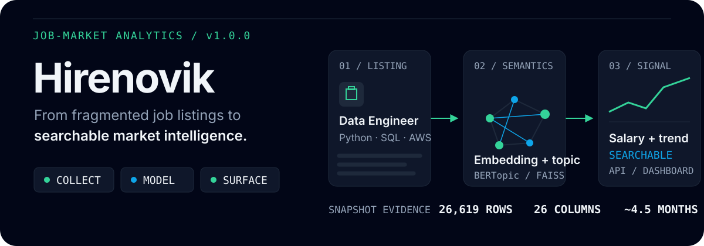
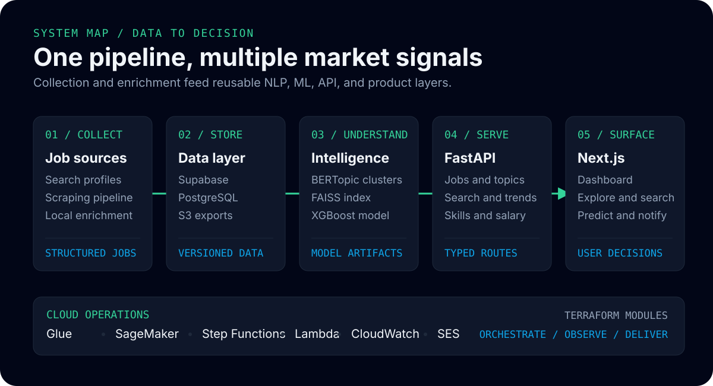

<p align="center">
  
</p>

<p align="center">
  
  
  
  
</p>

Hirenovik is an end-to-end job-market analytics platform for exploring technology roles through structured listings, semantic search, topic discovery, trend analysis, and salary estimation. It demonstrates a complete data product: collection and enrichment, NLP and ML pipelines, a typed API, an interactive frontend, and cloud infrastructure.

## Repository-backed proof

| Evidence | What the repository demonstrates |
| --- | --- |
| **26,619 rows / 26 columns** | The data-quality notebook records this specific analysis snapshot across approximately 4.5 months. It is evidence for that snapshot, not a claim of universal market coverage. |
| **6 API domains** | FastAPI routers expose jobs, topics, trends, skill extraction, semantic search, and salary prediction. |
| **5 product workflows** | The Next.js application provides jobs, topics, semantic search, trends, and salary-prediction pages, with an overview dashboard at the root. |
| **3 model-backed signals** | BERTopic discovers themes, FAISS retrieves semantically similar roles, and XGBoost supplies salary-prediction plumbing. |
| **Cloud-shaped delivery** | Terraform modules cover S3, Glue, SageMaker, Lambda, Step Functions, CloudWatch, and SES-backed notification infrastructure. |

## What it does

1. **Collects** job listings through configurable scraping profiles and execution modes.
2. **Enriches** raw records into structured, analysis-ready job data.
3. **Analyzes and indexes** descriptions with embeddings, BERTopic, FAISS, skill extraction, and trend generation.
4. **Predicts** salary ranges through an XGBoost-backed API path when the trained artifact is available.
5. **Surfaces and notifies** through a Next.js dashboard, FastAPI endpoints, exports, and notification infrastructure.

## System architecture

<p align="center">
  
</p>

The API loads model artifacts optimistically. The service remains available if an artifact is missing, while the affected topic, search, or prediction endpoint reports `503` instead of taking down the whole application.

## Product surfaces

| Surface | Decision supported |
| --- | --- |
| **Dashboard** | Orient quickly across the available analytics workflows and service state. |
| **Jobs** | Browse, filter, and inspect structured job records. |
| **Topics** | Explore clusters of related job-market language and representative listings. |
| **Semantic search** | Retrieve roles by meaning rather than exact keyword matching. |
| **Trends** | Inspect topic movement over the available analysis window. |
| **Salary prediction** | Submit skills and role context to the XGBoost-backed prediction path. |

## Quick start

### Prerequisites

- Docker with Docker Compose
- A populated `.env` based on the repository template
- Sufficient memory for the NLP/API container; Compose currently caps it at `14 GB`

### Run the product stack

```bash
cp .env.example .env
# Review .env and provide the configuration needed for your environment.
docker compose up --build
```

Then open:

- Frontend: [http://localhost:3000](http://localhost:3000)
- API documentation: [http://localhost:8000/docs](http://localhost:8000/docs)
- API health and model state: [http://localhost:8000](http://localhost:8000)

The health response reports availability independently for the embedder, topic model, search index, and XGBoost model. A successful container start does not imply that every model artifact is present.

## Evidence and limitations

- The `26,619`-row, `26`-column, approximately `4.5`-month figure is a recorded snapshot contract in [`notebooks/01_data_inventory_and_quality.ipynb`](./notebooks/01_data_inventory_and_quality.ipynb), not a live counter or universal dataset guarantee.
- [`notebooks/02_cross_site_duplicate_analysis.ipynb`](./notebooks/02_cross_site_duplicate_analysis.ipynb) derives duplicate-analysis evidence for the inspected data.
- Salary prediction is implemented as model-serving plumbing; this README makes no accuracy or performance claim.
- Coverage depends on configured sources, search profiles, collection windows, and source availability.
- The repository contains deployment and notification infrastructure, but this README does not claim a currently public deployment, uptime target, or guaranteed active email delivery.
- Local model-backed features require the corresponding BERTopic, FAISS, trend, and XGBoost artifacts.

## Technology

| Layer | Technologies |
| --- | --- |
| **Collection and data** | Python, pandas, SQLAlchemy, Supabase/PostgreSQL |
| **NLP and search** | Sentence Transformers, BERTopic, FAISS, scikit-learn |
| **Machine learning** | XGBoost, SageMaker model and inference infrastructure |
| **API** | FastAPI, Pydantic, Gunicorn, Uvicorn |
| **Frontend** | Next.js 16, React 19, Tailwind CSS 4, Recharts |
| **Cloud and operations** | AWS S3, Glue, Lambda, Step Functions, CloudWatch, SES, Terraform |

## Repository map

```text
src/
├── api/             FastAPI routers, schemas, services, and model loading
├── frontend/        Next.js analytics interface
├── nlp/             Embeddings, BERTopic, FAISS, preprocessing, and trends
├── ml/              XGBoost training and inference support
├── scrapers/        Collection and enrichment pipeline
└── notifications/   Matching, digest rendering, and delivery support
infrastructure/      Terraform modules and development environment wiring
notebooks/           Data-quality and duplicate-analysis evidence
step_functions/      Orchestration definitions and supporting code
tests/               Automated coverage across application layers
```

## License

Hirenovik is available under the [MIT License](./LICENSE).
